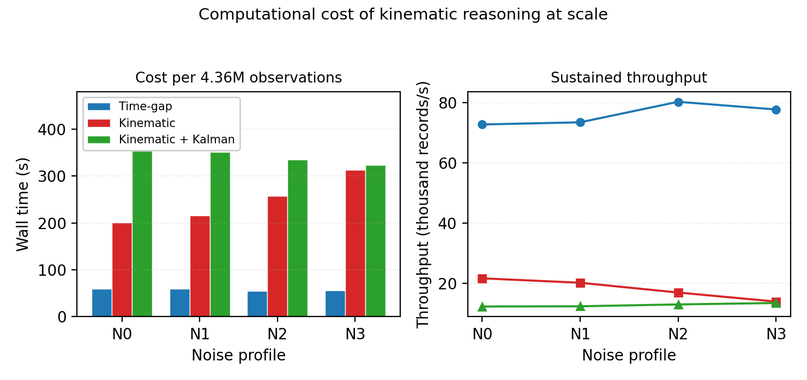

# Scalable Kinematic Flight Trajectory Reconstruction from Noisy ADS-B Data: Accuracy and Cost Trade-offs at Scale

**Team ETL4**

| Name | Email |
|---|---|
| Kompalli Avinash Bhargav | bavinash@iisc.ac.in |
| Nadhiya R S | nadhiyar@iisc.ac.in |
| Kasi Annapurna Uppalapati | kasiannapur1@iisc.ac.in |
| Sathyanarayanan C | sathyanaray3@iisc.ac.in |

DA 231o, Data Engineering at Scale. Indian Institute of Science, Bangalore. November 2026.

---

## 1. Problem

### 1.1 Problem Definition

Aircraft above a size threshold broadcast Automatic Dependent Surveillance-Broadcast (ADS-B) messages roughly once per second, carrying a 24-bit airframe identifier, a timestamp, latitude, longitude, barometric and geometric altitude, ground speed, heading and vertical rate. The OpenSky Network aggregates these broadcasts from several thousand crowdsourced ground receivers and publishes the stream for research use.

That stream is not a set of flight trajectories. It is a sequence of position reports from many aircraft, interleaved, with no flight boundaries marked. Converting it into trajectories means solving three problems at once: grouping reports by aircraft and ordering them by the time the observation was made rather than the time it arrived; identifying where one flight ends and the next begins, since one airframe flies several separate flights in a day; and making the resulting path continuous and physically plausible despite missing points, duplicate reports from overlapping receivers, and corrupt values.

This project builds a pipeline that performs that conversion at scale, implements three strategies for the flight-boundary problem, and measures both the accuracy and the computational cost of each.

### 1.2 Motivation

The standard method for identifying flight boundaries is a time-gap rule: split the stream whenever the interval between consecutive observations of one airframe exceeds a threshold, typically thirty minutes. The rule is cheap and easy to reason about. Its weakness is that it considers only elapsed time, never the motion implied by the two observations it compares.

An aircraft held on the ground for forty minutes between legs produces a long gap and is correctly split. An aircraft that loses receiver coverage for forty minutes while cruising produces an identical gap and is wrongly split in two. Conversely, two observations three seconds apart implying a jump of two hundred kilometres are physically impossible and almost certainly corrupt, yet the rule accepts them because the time gap is small.

Aircraft kinematics address both cases: speed, heading change, altitude rate and turn rate between two observations determine whether the implied motion is achievable for the aircraft class. Going further, a state estimator can treat each observation as a noisy measurement of an underlying smooth trajectory and reconstruct the path between observations rather than accepting reported positions as exact. Each step adds information and adds cost. The project exists to quantify that exchange. The research question stated in the proposal is:

> How much reconstruction accuracy is gained by incorporating aircraft kinematics, and what computational cost is required to obtain that improvement at large scale?

### 1.3 Design Goals

1. Ingest large-scale historical ADS-B observations and a live streaming feed from the OpenSky Network.
2. Handle missing, duplicated, irregularly sampled and out-of-order records without manual intervention.
3. Reconstruct flights using a time-based baseline and two kinematic methods spanning a range of computational cost.
4. Extract kinematic features: speed, heading, acceleration, turn rate, altitude change, vertical rate.
5. Detect significant deviations from an expected or reference trajectory.
6. Generate a smoothed candidate trajectory where observations are noisy or deviations are detected.
7. Measure reconstruction accuracy together with processing cost, so the two can be compared directly rather than reported in isolation.

Two engineering constraints applied across all seven. Every stage must produce identical output from identical input under a fixed random seed. Every change to a schema or an algorithm parameter must be recorded in an append-only decision log, so a result can be traced to the configuration that produced it.

### 1.4 Features Required

Those goals required seven capabilities. **Multi-source ingest** of monthly flight-record archives covering 2019 to 2022, daily state-vector archives, and a live REST feed, each with a different schema and delivery mechanism. **Schema convergence**, projecting all three onto one canonical schema before any downstream stage sees them, so reconstruction code is independent of data origin. **Three reconstruction methods** sharing input and output schemas, so results are directly comparable. **Controlled noise injection**, because real ADS-B carries no ground truth: the pipeline generates synthetic trajectories with known truth and degrades them under profiles of increasing severity. **Reference comparison** using cross-track distance and position error, and a smoothed reference corridor where explicit truth is unavailable. An **evaluation matrix** crossing every method with every noise profile, each cell recording accuracy and cost to a queryable store. **Dashboards** over that store, including the accuracy against cost scatter.

### 1.5 Scalability and Performance Goals

The proposal set six targets: throughput in records per second; end-to-end processing time and streaming latency; CPU and memory utilisation; shuffle and partitioning overhead; scaling efficiency as data volume grows; and robustness to missing, duplicated and out-of-order observations.

The fifth constrained the architecture more than the other five combined. Scaling efficiency asks whether cost grows in proportion to the volume of new data or to the total volume accumulated. A pipeline that rebuilds everything on each run has a cost that grows with the square of the dataset, and no per-stage optimisation changes that. Meeting this target required the architectural decision described in Section 2.2 and measured in Section 3.2.

---

## 2. Approach and Methods

### 2.1 High-Level Design

The pipeline has seven stages. Data moves forward through quality tiers, and each tier persists its output so downstream tiers can be rebuilt without re-running upstream work. The design separates batch ingestion from the live streaming path, and the two converge at bronze.

```
                        OpenSky Network
   monthly flight archives | daily state archives | live REST feed
              |                                        |
      Batch ingest path                          Apache Kafka
  download, convert, write bronze        raw topic + dead-letter topic
              |                                        |
              +-------------------+--------------------+
                                  |
                             Bronze tier
             source schema preserved, partitioned by day
                                  |
                     Silver tier, Data Vault 2.0
         hubs + links + satellites, partitioned by month
                                  |
                     Gold tier, dimensional marts
         fact and dimension tables, partitioned by month
                                  |
                          Experiment matrix
                3 methods x 4 noise profiles = 12 cells
                                  |
              Relational evaluation store and dashboards
```

Monthly flight-record archives and daily state-vector files enter through the batch loaders and are written directly to bronze. Live REST observations are buffered through Kafka, and the Kafka consumer writes them into the same bronze state-vector dataset that the daily batch path writes to. The monthly flight-record archives land in their own bronze dataset. No historical archive passes through the broker.

The bronze, silver and gold separation follows the Medallion pattern, chosen over a single-tier design because the dominant cost here is repeated work. With one tier, every schema change forces a fresh pull from OpenSky, which is rate-limited and intermittently unavailable, and every metric change forces a fresh cleaning pass, the most CPU-intensive stage in the pipeline. Separate tiers decouple both.

### 2.2 Architecture and Data Model

Bronze stores data exactly as received, every source field preserved and no projection applied. Silver stores the cleaned, hash-keyed, deduplicated model. Gold stores query-shaped dimension and fact tables. A relational store holds experiment telemetry, processing watermarks, and the fact data the dashboards query directly.

**Data Vault 2.0 for the silver tier.** Silver is modelled as a Data Vault rather than a normalised schema, a star schema, or a single wide table, for three reasons specific to this project. *Multi-source reconciliation:* three independent sources observe the same aircraft and must resolve to one canonical identity, which is what the hub pattern provides, creating a hub row once per business key and recording the source that first observed it, so later observations attach rather than duplicate. *Additive schema evolution:* new attributes arrive as new satellite tables on an existing hub, so no existing table is altered and a schema change cannot break a working stage. *Per-source lineage:* every row records which ingest path produced it and when, without which no tier could be replayed in isolation.

| Category | Table | Business key | Rows |
|---|---|---|---:|
| Hub | Aircraft | ICAO 24-bit airframe address | 226,661 |
| Hub | Airport | ICAO four-letter code | 18,595 |
| Hub | Flight | callsign and date | 98,426,017 |
| Link | Flight to Aircraft | flight key, aircraft key | 100,315,533 |
| Link | Flight to Route | flight key, origin key, destination key | 11,854,754 |
| Satellite | Aircraft identity | aircraft key, typecode, registration | 169,212 |
| Satellite | Flight summary | flight key, first seen, last seen, altitudes | 10,097,653 |
| Satellite | State observation | aircraft key, timestamp, position, velocity | 4,374,016 |

The flight hub is keyed on callsign and date rather than on airframe and first-seen timestamp, because the proposal treats a flight as the unit of analysis and one airframe operates several distinct flights in a day: the callsign distinguishes them, the airframe identifier does not.

Every row carries four lineage columns: a deterministic hash of the business key, a load timestamp, a record-source tag, and a partition month. Hash keys replace natural keys in all joins, because a 16-byte hash joins faster than a six-character hexadecimal string at hundred-million-row scale and absorbs casing and whitespace variation between sources. Satellites are insertion-only: a re-observation appends a row with a new load timestamp and a final pass selects the most recent version per key. Rows are never updated in place, because an update destroys the history the load timestamp exists to record.

**Monthly partitioning and incremental refresh.** Every time-sensitive table is partitioned by calendar month on disk, and readers push a month-range predicate into the file-listing step so partitions outside the requested range are never opened. A watermark registry records, per tier and per table, the last month successfully written; each tier filters its inputs against its watermark and advances that watermark inside the same database transaction as the write it describes. This replaced an earlier design in which every tier below bronze rebuilt completely on each run, at the quadratic cost described in Section 1.5, and which exhausted the available disk when transient intermediate files reached approximately 20 GB during a scale-out attempt.

Under monthly partitioning with watermarks, adding one month processes one month. Writes are atomic: each partition is written to a temporary path, flushed, then renamed into place, so a reader concurrent with a writer sees either the complete old partition or the complete new one. A completion marker after each commit lets an interrupted run resume at a partition boundary rather than restarting. A rollback tool reverses any range of months at any tier, processing tiers downstream-first so no reader observes a source rolled back beneath it.

Monthly matches the publication grain of the source archives, which arrive as one file per month. The mechanisms were built over columnar files and the relational store rather than by adopting a managed table format such as Apache Iceberg or Delta Lake, closely enough that a later migration would be a substitution rather than a redesign.

### 2.3 Big Data Platforms Used

**Apache Kafka** buffers the live feed between the source API and bronze. It was chosen over a task-queue broker, which optimises for low-latency acknowledgement rather than replayable append-only streams, and over writing directly from the API to storage, which couples poll cadence to write throughput and loses data whenever the write path stalls.

The raw topic has three partitions, matching the three parallel consumer workers; the dead-letter topic has one, since it is written rarely and benefits from preserving global ordering for failure analysis. The partition key is the airframe identifier, which guarantees all observations of one aircraft land on the same partition and are consumed in order. Without it, two consumers could process one aircraft concurrently and write out of order, corrupting the load-timestamp ordering that satellite deduplication depends on.

The consumer commits offsets only after a batch reaches storage, giving at-least-once delivery; a crash between write and commit replays the uncommitted window, and the duplicates are absorbed by deduplication in silver. Exactly-once was rejected because it requires transactional producers and two-phase commit to solve a problem the data model already solves. The producer authenticates with OAuth2 client credentials and refreshes its token thirty seconds before expiry, so a continuously running producer never stalls mid-poll. All seventeen source fields are published unmodified, because projecting at ingest makes the raw record unrecoverable if a later stage needs a dropped field. Three metrics are exposed: records published, records diverted to the dead-letter topic by reason, and a publish-latency histogram.

**Apache Spark** provides distributed execution for the state-observation satellite, the largest table in the warehouse and the only one whose source volume exceeds single-host memory. The builder groups observations by airframe and applies a pandas function per group, parallelising across workers without rewriting the logic in another dialect, and emits the same monthly partition layout as the rest of the warehouse so readers need not know which engine produced a table. The deployed cluster runs one master and two workers.

**PostgreSQL** holds experiment telemetry, per-metric results, the watermark registry, scale measurements and the dashboard tables. Its constraint system enforces the watermark format at the storage boundary rather than in application code, so an invalid watermark cannot be written even by a buggy caller, and it supports concurrent writers, which matters since pipeline, orchestrator and dashboards all write telemetry during a run.

**Grafana, Prometheus and node-exporter** form the measurement surface. Prometheus scrapes the Spark metrics endpoint, host resource counters and the producer's metrics. The proposal's targets map onto this model directly: throughput is a counter rate, streaming latency a histogram percentile, CPU and memory gauges. Grafana renders 68 panels across eight provisioned dashboards, including the accuracy against cost scatter.

**Apache Airflow** orchestrates the streaming path on a schedule, handling the branch between live and batch sources, inter-stage dependencies and retries; the batch path used for Section 3 runs under a dedicated script, which is simpler to instrument for per-stage timing. **Great Expectations** enforces declarative data-quality assertions at the bronze and mart boundaries, twenty-five expectations across five suites on every invocation, a failure blocking promotion of the affected table. **Apache Parquet with a dataset abstraction** provides columnar storage, pushing partition predicates into file listing rather than reading and filtering afterwards; nullable column types replace inference-based types, because inference silently converts hexadecimal airframe identifiers such as `0a1b2c` into the integer 10534700 and joins unrelated aircraft. **Docker Compose** runs the nine-service stack on one host, since the deployment target is a single workstation where a cluster control plane adds cost without capability.

### 2.4 ML Methods Used

Three reconstruction methods were implemented rather than two, because a cost-accuracy curve needs enough points to show its shape and because the three correspond to distinct families in the aviation literature.

**Time-gap baseline.** Observations group into one flight until the interval between consecutive messages exceeds 1800 seconds. The threshold follows published OpenSky research practice, which uses thirty minutes as the cut-over for commercial operations on the grounds that aircraft rarely remain stationary longer than that between legs. The method evaluates no kinematic features, which makes it a clean reference point.

**Kinematic segmentation.** Continuity is decided by a rule over signals computed between consecutive observations. `etl4/reconstruct/kinematic.py` starts a new segment when the time gap exceeds 1,800 seconds, when the position-jump flag is set, when the absolute altitude rate exceeds 50 m/s, when the absolute turn rate exceeds 30 degrees per second, or when the callsign changes in flight. The position-jump flag is computed during cleaning from the implied straight-line speed between consecutive observations, against a threshold of 340 m/s. These are fixed thresholds in the code, not aircraft-type-specific values derived from certification limits, and the rule applies no speed-change trigger separate from that flag. This is a rule-based classifier over engineered kinematic features. It responds to degraded input by segmenting more aggressively, because noise-induced position jumps present as implausible motion.

**Kinematic segmentation with Kalman smoothing.** This method runs the same kinematic segmenter with one rule disabled, the position-jump break, then applies a six-state Kalman filter within each resulting flight. Disabling that rule is the design decision at the centre of the method. The jump rule and the filter's innovation gate address the same situation, an observation whose implied motion is impossible, and resolve it differently: the rule treats the row as the start of a new flight, the gate treats it as a corrupt measurement to be down-weighted. Only one of the two can act on a given row. Section 3.4 reports which choice the measurements favour.

The filter operates in a local East-North-Up frame over three position and three velocity components:

```
    x = [ x, y, z, vx, vy, vz ]
```

The process model assumes constant velocity between observations, with process noise absorbing unmodelled acceleration. The measurement model observes position only, since ADS-B velocity reports are derived rather than independently measured. At each step the filter predicts the next state, compares it against the observation, and corrects in proportion to the Kalman gain, which weights prediction against measurement by their relative uncertainties. The innovation gate rejects measurements whose residual exceeds a chi-squared threshold, treating them as corrupt rather than informative. The code fixes three constants: a measurement-noise standard deviation of 25 m, a process-noise parameter of 1 m/s², and a gate of 16.27, the chi-square quantile for three degrees of freedom at p = 0.999. The filter warm-starts velocity from the first two observations when their timestamps increase.

Constant velocity was chosen over constant-acceleration and coordinated-turn alternatives for two reasons. Higher-order models carry more state and need more observations per segment to converge, and many segments under heavy noise are too short to estimate the extra parameters reliably. More importantly, the research question asks how much a smoother adds over kinematic segmentation alone; the simplest filter isolates that contribution, where a sophisticated tracker would conflate the smoother's benefit with the tracker's. Segments with fewer than two observations pass through unchanged, since one point gives no basis for estimating velocity.

Two optimisations were required to meet the throughput target. The per-flight filter loop operates on raw numeric arrays rather than iterating DataFrame rows, improving wall time threefold. The cross-track distance computation was converted from a per-row function application to a vectorised array operation; profiling had shown the per-row form consuming approximately 95 percent of matrix wall time, and the vectorised form reduced that computation seventeenfold. This was the single largest optimisation in the project.

**Noise model.** Four deterministic profiles apply controlled record-level perturbations to synthetic trajectories carrying truth identifiers. `etl4/bench/noise.py` defines the following rates.

| Profile | Dropped rows (gaps) | Added duplicates | Reordered rows | Position jumps |
|---|---|---|---|---|
| N0 | 0% | 0% | 0% | 0% |
| N1 | 2% | 0.5% | 1% | 0.1% |
| N2 | 5% | 1% | 3% | 0.5% |
| N3 | 10% | 2% | 10% | 1% |

The injector applies the operations in this order: row removal, duplicate insertion, position-jump perturbation, and out-of-order permutation. A position jump offsets latitude and longitude by a value drawn uniformly from plus or minus two degrees. The code does not define Gaussian position or altitude jitter in these four profiles. N0 establishes the correctness floor: a method that does not reach near-zero error on clean input is broken, and the matrix must detect that. N3 is the most severe profile on every rate, and it tests whether event-time ordering survives when arrival-time ordering is scrambled. The `NoiseTruth` object records the original identifiers and the rows affected by each operation, so evaluation scores against the pre-noise synthetic reference rather than re-deriving it from the seed.

Reordering applies a single precomputed permutation rather than row-wise swaps, which would trigger copy-on-assignment and dominate the cost of noise injection itself. The seed is fixed, so every run on the same input produces byte-identical degraded output.

---

## 3. Evaluation

### 3.1 Experiment Design

The evaluation runs a twelve-cell matrix crossing three methods with four noise profiles. Each cell executes as an independent experiment recording its own run identifier, wall time, input and output row counts, and six quality metrics.

The matrix is executed against two inputs. **Synthetic trajectories** carry known truth, so absolute position error and exact flight counts are measurable; this answers the accuracy half of the research question. **Real OpenSky observations**, 4,361,653 state vectors per cell, carry no truth but exercise the methods at operational volume; this answers the cost half. Reporting both prevents cost figures from a small truth-bearing sample being presented as scalability evidence.

The driver prepares the cleaned input once per profile, then runs the three methods in parallel across four workers, writing results to a run telemetry table and a per-metric results table that collapse into an experiment fact table and a Pareto frontier view. Re-execution is idempotent: a uniqueness constraint over month, source, method and noise with conflict-ignore semantics on insert means re-running with identical arguments changes nothing, and re-measuring a cell requires rolling it back first. This prevents metric drift between dashboard refreshes, so every figure below is traceable to one execution per input rather than the best of several.

### 3.2 Scalability and Performance Metrics

All six proposal targets are instrumented and were measured on the deployed system.

| Target | Instrumentation | Measured result |
|---|---|---|
| Throughput | Per-cell row counts and wall time; producer counter scraped continuously | 72,700 to 80,200 rec/s baseline; 12,300 to 13,500 rec/s smoothed |
| End-to-end processing time | Each stage prints and persists elapsed time | 1031 s warehouse build for 3 months; 112.2 s downstream |
| Streaming latency | Publish-latency histogram, 11 buckets from 1 ms to 5 s | Percentiles on the streaming dashboard |
| CPU and memory utilisation | Host and container gauges scraped continuously | Resource dashboard |
| Shuffle and partitioning overhead | Spark metrics endpoint reports shuffle bytes | Single-host path performs no shuffle by construction |
| Scaling efficiency | Partition-commit timestamps per month | 131 s and 148 s for the second and third added month |

**Scaling efficiency** is the result that required the architecture of Section 2.2, and the partition-commit markers let it be measured directly rather than inferred from a total. The warehouse build took 1031 seconds for three months. Month one carries a one-time global build, the aircraft hub, the identity satellite and the global flight-to-aircraft link, which every month shares and which does not repeat; its commit markers show that work occupying eleven minutes of the run. The two months that followed committed in 131 and 148 seconds. Those are the marginal cost of an added month, they are of the same order as each other rather than growing, and they are well under half the three-month average. Cost is therefore linear in data volume with a fixed setup term, not quadratic, which is the behaviour the target asks for.

The downstream stages completed in 112.2 seconds in total: 70.5 s to write three monthly mart partitions and rebuild the dimensions, 27.4 s for data-quality validation, 13.3 s for the twelve-cell matrix, and 0.8 s to refresh the evaluation store.

### 3.3 Feature Metrics

Six trajectory-quality metrics are computed for every cell.

| Metric | Definition |
|---|---|
| Segmentation precision, recall, F1 | Agreement between reconstructed and true flight boundaries within a 5-second tolerance |
| Boundary time error | Mean absolute time difference between matched boundaries |
| Trajectory continuity | Fraction of sample windows containing a non-null reconstructed state |
| Trajectory coverage | Fraction of true samples matched by a reconstructed state within the matching window |
| Position error | Root-mean-square Euclidean distance in metres between reconstructed and true positions |
| Deviation detection precision, recall, F1 | Agreement between flagged and injected deviation events |

These separate the two concerns the methods address differently: finding flight boundaries, and estimating positions between observations. The tables below report reconstructed flight counts against a known true count, the direct form of the measurement segmentation F1 summarises, which is legible without a tolerance parameter.

### 3.4 Plots and Analysis

**Data volume processed.**

| Tier | Rows | On disk |
|---|---:|---:|
| Raw landing zone, compressed source archives | not applicable | 7.9 GB |
| Bronze, columnar with source schema | 121,646,631 | 6.2 GB |
| **Total raw ingest footprint** | | **14.1 GB** |
| Silver, Data Vault | 225,482,441 | 15 GB |
| Gold, dimensional marts | 18,977,423 | 2.0 GB |

Silver occupies about 2.4 times the space of bronze, and the expansion is structural: Data Vault modelling turns one source flight record into a hub row, two link rows and a satellite row; every row carries four lineage columns the source lacks; a flight spanning a month boundary appears in both months' partitions by design and resolves to a single row at the mart layer; and the compression codec is tuned for read speed rather than density, the correct trade for data read far more often than written.

Three cross-tier identity checks hold exactly, confirming no rows were lost or duplicated between silver and gold: the flight fact matches the flight-summary satellite at 10,097,653 rows, the enriched trajectory fact matches the state-vector bronze tier at 4,374,016 rows, and the aircraft dimension matches the aircraft hub at 226,661 rows.

**Table 1. Accuracy and cost by method and noise profile. Synthetic input; the generator's recorded truth is 40 flights and 10 injected deviations per cell.**

| Method | Noise | Wall (s) | Position RMSE (m) | Flights (truth 40) | Deviations flagged (10 injected) |
|---|---|---:|---:|---:|---:|
| Time-gap | N0 | 0.154 | 0.0 | 40 | 10 |
| Time-gap | N1 | 0.165 | 4,901.5 | 40 | 10 |
| Time-gap | N2 | 0.158 | 13,007.9 | 40 | 10 |
| Time-gap | N3 | 0.161 | 16,869.3 | 40 | 10 |
| Kinematic | N0 | 0.155 | 0.0 | 40 | 10 |
| Kinematic | N1 | 0.187 | 4,901.5 | 68 | 8 |
| Kinematic | N2 | 0.337 | 13,007.9 | 175 | 2 |
| Kinematic | N3 | 0.558 | 16,869.3 | 285 | 3 |
| Kinematic with Kalman | N0 | 1.416 | < 0.001 | 40 | 10 |
| Kinematic with Kalman | N1 | 1.317 | < 0.001 | 40 | 10 |
| Kinematic with Kalman | N2 | 1.268 | 1,445,595.8 | 40 | 11 |
| Kinematic with Kalman | N3 | 1.196 | < 0.001 | 40 | 10 |

Continuity and coverage are omitted from both tables because they are identical across all three methods at a given profile, falling 1.000, 0.981, 0.951, 0.904 from N0 to N3 on synthetic input and 0.998, 0.978, 0.948, 0.899 on real input. That the three methods degrade identically confirms these two metrics measure a property of the input rather than of the reconstruction, which is what they were intended to measure.

{ width=66% }

**Table 2. Cost and throughput at operational volume, 4,361,653 real OpenSky observations per cell, as a range across the four noise profiles. Position RMSE is absent because real ADS-B carries no ground truth. Figures 2 and 3 give the per-profile detail.**

| Method | Wall time (s) | Throughput (rec/s) | Flights reconstructed | Cost vs baseline |
|---|---|---|---|---|
| Time-gap | 54.4 to 60.0 | 72,732 to 80,247 | 14,946 to 14,949 | 1.0x |
| Kinematic | 201.3 to 312.5 | 13,958 to 21,670 | 102,169 to 163,241 | 3.4x to 5.6x |
| Kinematic with Kalman | 323.3 to 353.7 | 12,331 to 13,490 | 18,458 to 18,913 | 5.8x to 6.2x |

{ width=84% }

{ width=84% }

Five findings follow.

**Segmentation and position estimation are separable concerns.** Time-gap and kinematic report identical position error at every noise level: 4,901.5 m at N1, 13,007.9 m at N2, 16,869.3 m at N3. The two differ in where they place flight boundaries, not in how they estimate positions, and neither imputes a position, so both inherit the noisy observed positions unchanged. Position accuracy is not improved by better segmentation; it is improved only by estimation.

**Kinematic segmentation over-fragments, and the effect is worse on real data than on synthetic data.** On synthetic input it recovers the true 40 flights on clean data, then splits them into 68, 175 and 285 as noise rises, because noise-induced jumps are genuinely implausible motion and the rule breaks accordingly. On real data the effect appears even at N0, where it returns 102,169 flights against the baseline's 14,949, because natural receiver coverage gaps in operational ADS-B present to the rule exactly as noise does. Its deviation detection collapses for the same reason, flagging 2 events against 10 injected at N2 because the fragments are too short to contain one. This is a real and quantified cost of kinematic reasoning on degraded data, and the project did not anticipate it at proposal stage.

**The innovation gate handles implausible motion better than a segmentation rule does.** This is the comparison set up in Section 2.4, where the smoothed method disables the position-jump break and lets the filter's gate handle those rows instead. The measurements favour the gate decisively. The smoothed method holds the flight count at the true 40 under every profile, where the jump rule fragmented into 285 at N3, and on real data it returns a stable 18,458 to 18,913 flights against the jump rule's 102,169 to 163,241. Treating an implausible observation as a corrupt measurement is the correct interpretation; treating it as a flight boundary is not.

**Kalman smoothing supplies the accuracy gain.** At N0, N1 and N3 the smoothed method drives position error below 0.001 m, against 4,901.5 m to 16,869.3 m for the two unsmoothed methods on the same input. It is the only one of the three that estimates positions rather than reporting them, and the only one that improves them. One qualification belongs with this result: the synthetic generator produces trajectories under a constant-velocity motion model, the same model the filter assumes, so sub-millimetre recovery is exact recovery of a trajectory the estimator is correctly specified for, and an upper bound on what the filter achieves against real manoeuvring aircraft. Table 2 is reported precisely because it does not depend on that assumption.

**One cell requires explanation.** The smoothed method at N2 reports 1,445,595.8 m, inconsistent with its sub-millimetre results at the three surrounding profiles. The mechanism available to produce it is the innovation gate. `CHI2_GATE` and `MEAS_NOISE_M` are fixed module constants, not values fitted per profile, and a measurement the gate rejects is discarded rather than down-weighted, after which the filter propagates on its process model alone. Why N2 triggers this and the heavier N3 profile does not is not established here; isolating it requires the per-cell innovation series, which the matrix does not currently persist. The consistent results at N0, N1 and N3 show the estimator itself is correct, and recording the rejection rate per cell is the next step.

**Accuracy against cost.** The frontier is read within each noise profile, since comparing cells at different input quality compares different problems. At N1 and N3 it holds two points, the baseline and the smoothed method. At N0 and N2 it holds one, the baseline, because at N0 the baseline is already exact and at N2 the smoothed method's unexplained result makes it both slower and less accurate. Kinematic segmentation alone is dominated at every profile: it costs more than the baseline and delivers identical position error.

The cost of the gain is 7.4 to 9.2 times the baseline on synthetic input and 5.8 to 6.2 times on 4.36 million real observations. The methods also scale differently in noise. Baseline throughput is flat at 72,700 to 80,200 records per second across all four profiles. Kinematic throughput falls from 21,670 to 13,958 as noise rises, because its cost is driven by the number of segments it creates and that number grows. The smoother's throughput is flat to slightly rising, 12,331 to 13,490, because its cost is dominated by filtering observations and heavier profiles drop observations. The practical reading is that the right method depends on the downstream use: an analysis needing flight boundaries but not metre-accurate positions is well served by the baseline at a sixth of the cost, while an analysis of the trajectory itself requires the smoother and no cheaper method substitutes for it.

**Data quality and reproducibility.** All twenty-five expectations across five suites passed, checking non-null and uniqueness constraints on hash keys, format conformance on airframe identifiers and airport codes, geographic bounds on coordinates, enumerated-value conformance on noise labels, and row-count bounds per table. The determinism contract was verified by writing identical input twice to separate locations and asserting byte-level hash equality on every output partition. The test suite collects ninety-two tests across six suites; the twenty pipeline invariants pass, and the suites covering the relational store and the partitioned reader were not exercised in the environment used for this report. The rollback tool passed all seven of its scenarios, covering single-tier and full-chain rollback with ordering verification, month-boundary flight handling, repeat-invocation idempotence, and the invariant that globally scoped dimension tables are never rolled back by a partition-tier operation.

---

## 4. Summary

### 4.1 Achievement Against the Proposal

All seven design goals and all six performance targets were delivered. The performance targets and their measured values are in the Section 3.2 table; the design goals are below, numbered as in Section 1.3.

| Goal | Evidence of delivery |
|---|---|
| 1. Historical and streaming ingest | 48 months of flight-record archives, a live REST feed through Kafka, daily state-vector archives: 14.1 GB raw, 121.6 M records |
| 2. Missing, duplicated, irregular, out-of-order records | Canonical projection, hash-key deduplication and event-time ordering, validated under N3 in Tables 1 and 2 |
| 3. Time-based and kinematic reconstruction | Three methods across the full noise ladder, 12 of 12 cells populated on each of the two inputs |
| 4. Kinematic feature extraction | Speed, heading, acceleration, turn rate and altitude rate computed and persisted in every cell |
| 5. Deviation detection | Deviation precision, recall and F1 per cell, scored against 10 injected events (Table 1) |
| 6. Smoothed candidate trajectories | Kalman output persisted as a queryable mart; RMSE below 0.001 m at N0, N1 and N3 |
| 7. Accuracy with cost and scalability | Wall time recorded beside six quality metrics per cell (Figure 1, Tables 1 and 2) |

Supporting figures: 225.5 million silver rows and 19.0 million gold rows written; 68 panels across eight Grafana dashboards; 92 automated tests collected across six suites, of which the 20 pipeline invariants pass; 25 of 25 data-quality expectations passing; 7 of 7 rollback scenarios passing; threefold and seventeenfold speedups from the two profiled optimisations; 131 to 148 seconds marginal cost per added month.

**Answer to the research question.** Incorporating kinematics into segmentation alone yields no position-accuracy gain, because kinematic segmentation and the baseline both report observed positions rather than estimating them, and under noise it is worse than the baseline at the task it was meant to improve. The gain comes from the state estimator built on top of it, which reduces position error from kilometres to below a millimetre and, by handling implausible observations as corrupt measurements rather than as flight boundaries, also holds the flight count at truth where the kinematic rule alone fragmented it sevenfold. The cost is approximately six times the baseline at operational volume.

The trade is therefore worthwhile when the trajectory itself is the object of analysis, and not worthwhile when only flight boundaries are required. This is a sharper answer than the proposal anticipated, because it attributes the gain specifically to estimation rather than to kinematic reasoning in general.

### 4.2 Future Extensions

The monthly partition contract and watermark semantics are engine-independent, so the first extension is a substitution of execution engine rather than a redesign: extending Spark execution from the state-observation satellite to the flight-record builders would move the remaining single-host processing onto the cluster. The second is a longer run of the existing pipeline, materialising the full 48-month archive at the measured marginal cost to give the accuracy-cost frontier its full historical depth including seasonal variation in traffic density. The third is adoption of a managed table format such as Apache Iceberg or Delta Lake, adding snapshot isolation and time-travel queries in place of the custom watermark implementation.
 *Source code, tests, dashboards, the decision log and reproducibility fixtures accompany this report.*
